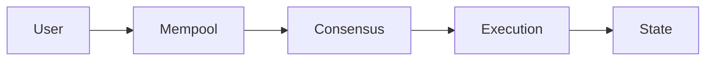

# Architecture — <Chain name>

- Version: 0.1 (YYYY-MM-DD)
- Status: draft | reviewed | accepted (ADR-....)

## 1. Overview
Architecture class, one paragraph. Why this class (link the ladder reasoning / ADR).

## 2. Actors and node roles
| Role | Does | Count (now → target) | Permission | Hardware / connectivity | Stakes / bonds | Rewarded for | Penalised for |
|---|---|---|---|---|---|---|---|

## 3. Trust assumptions
| ID | Assumption | Needed for (safety / liveness / exit / fairness) | If violated |
|---|---|---|---|
| T1 | | | |

## 4. Components
| Component | Responsibility | Owner skill (protocol-*) | Depends on |
|---|---|---|---|

## 5. Lifecycles
### Transaction
Submission → propagation → inclusion → execution → finality → observable by clients. Note latency budget per step.

### Block / epoch
What happens every block, every epoch (rotation, rewards, assignments).

## 6. Failure scenarios
| Scenario | Expected behaviour | Recovery |
|---|---|---|
| > 1/3 consensus power offline | | |
| Network partition | | |
| Extra-layer nodes (verifiers, community nodes) disappear | | |
| Malicious majority in a committee | | |
| Bridge / DA layer unavailable | | |
| Key compromise of privileged role | | |

## 7. Cross-cutting
Determinism, upgrade path, governance scope, privacy, observability.

## 8. Open points
Links to Q-items and K-risks in CHAIN.md.
