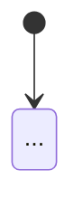

# <Component> spec

- Spec ID: <COMP> (short code used in IDs)
- Version: 0.1 — YYYY-MM-DD
- Status: draft | reviewed | specified
- Mechanism skill: protocol-<…>
- Requirements covered: R-F…, R-N…
- Decisions: ADR-…

## 1. Purpose and scope
What this component is responsible for, and what it explicitly is not.

## 2. Actors and permissions
| Actor | Can do | Authorization |
|---|---|---|

## 3. State
| Name | Type (with bounds) | Key | Written by | Notes |
|---|---|---|---|---|

## 4. Operations
<!-- one block per op, notation in design-spec/references/notation.md -->
```
op <Name>(caller: Address, ...)
  auth:
  checks:
    C1 ... → Err...
  effects:
    E1 ...
  emits:
  cost:
```

## 5. Hooks (per block / per epoch / on upgrade)
```
hook <Name>(...)
  bound:
  steps:
```

## 6. Queries
| Query | Inputs | Returns | Paginated / bound |
|---|---|---|---|

## 7. Parameters
| ID | Type | Default | Min | Max | Unit | Changed by | Runtime-change effect |
|---|---|---|---|---|---|---|---|
| P-<COMP>-... | | | | | | gov / none | |

## 8. Invariants
| ID | Statement | Checked by (test / model) |
|---|---|---|
| INV-<COMP>-1 | | |

## 9. Lifecycles


## 10. Events and errors
| Event | Fields | When |
|---|---|---|

| Error | Raised by | Meaning |
|---|---|---|

## 11. Interactions
| Other component | Calls / is called | Data exchanged | Failure handling |
|---|---|---|---|

## 12. Failure and adversarial cases
| Case | Actor | What they try | Component response |
|---|---|---|---|

## 13. Upgrade and migration notes
What state layout changes would require, compatibility constraints.

## 14. Acceptance criteria / test vectors
| # | Given | When | Then |
|---|---|---|---|

## 15. Open questions
- Q…

## Changelog
- 0.1 — initial
