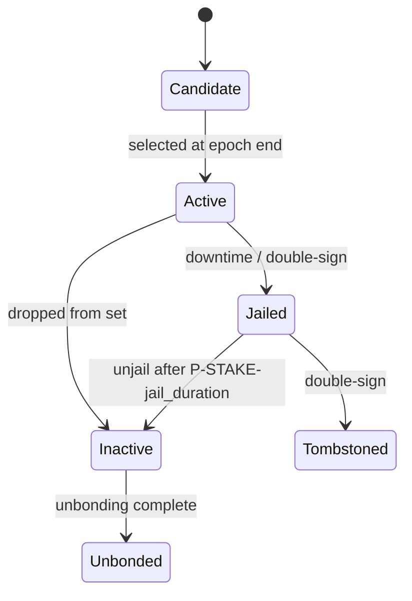

# Spec notation

A neutral notation that maps cleanly onto any stack: Go modules, Rust pallets, Solidity contracts, off-chain services.

## Types

| Type | Meaning | Maps to (examples) |
|---|---|---|
| `Address` | account identity (20 or 32 bytes, encoding is a stack detail) | sdk.AccAddress, H160, AccountId32, address |
| `Amount` | unsigned integer in base units, never negative, ≥ 128 bits | math.Int, U256, u128, uint256 |
| `SignedAmount` | signed integer in base units | math.Int, I256, int256 |
| `Dec` | fixed-point, 18 decimals unless stated | LegacyDec, Perbill/FixedU128, uint256 scaled 1e18 |
| `Ratio` | fixed-point in [0, 1] | Perbill, Dec, basis points (uint16) |
| `Height` | block number | uint64 |
| `Epoch` | epoch number | uint64 |
| `Time` | consensus time (block header), seconds or ms stated | block time |
| `Duration` | consensus-time span | — |
| `Hash` | 32-byte digest, function stated (sha256, keccak256, blake2b) | — |
| `Bytes`, `String<max>` | bounded raw data / UTF-8 text | — |
| `PubKey<scheme>` | public key, scheme stated (ed25519, secp256k1, bls12-381) | — |
| `Sig<scheme>` | signature | — |
| `Map<K, V>` | keyed storage; iteration order = ascending key bytes | KV store, StorageMap, mapping + index |
| `List<T, max>` | ordered, bounded | — |
| `Set<T, max>` | unique, bounded | — |
| `Option<T>` | may be absent | — |
| `Enum{A, B}` | closed set of variants | — |
| `Coin{denom, amount}` | asset amount | sdk.Coin, (token, amount) |

Every collection has a max size or a cost per item. Write the bound next to the type.

## Operations

```
op Delegate(caller: Address, validator: ValidatorId, amount: Amount)
  auth:   caller signs
  checks:
    C1  amount > 0                                   → ErrZeroAmount
    C2  validators[validator] exists                 → ErrUnknownValidator
    C3  validators[validator].status ∈ {Active, Inactive}  → ErrValidatorJailed
    C4  balance(caller) ≥ amount                     → ErrInsufficientFunds
  effects:
    E1  transfer(caller → BondedPool, amount)
    E2  shares := amount * v.total_shares / v.tokens        # round DOWN (protocol favour)
    E3  delegations[(caller, validator)].shares += shares
    E4  v.tokens += amount ; v.total_shares += shares
  emits:  Delegated{caller, validator, amount, shares}
  cost:   O(1) storage writes: 3
```

- Checks are evaluated in order; the first failing check aborts with no state change.
- Effects are applied atomically and in order.
- `:=` local binding, `+=`/`-=` state update, `→` transfer or error.

## Hooks

```
hook EndEpoch(e: Epoch)
  bound:  at most P-STAKE-max_validators items sorted + P-STAKE-max_unbond_per_epoch processed
  steps:  ...
```

## Determinism rules (apply to every op and hook)

1. Integer or fixed-point arithmetic only — no floating point anywhere in consensus logic.
2. Every division states its rounding (`round DOWN`, `round UP`, `round HALF-EVEN`) and where the remainder (dust) goes. Default: round in the protocol's favour; dust stays in the pool/reserve.
3. Overflow: state whether an op aborts or saturates. Default: abort.
4. Iteration over maps/sets uses a defined order (ascending key) and has a bound.
5. Time comes only from consensus (block time/height). Never wall clock.
6. Randomness comes only from a specified source (`protocol-randomness`), never block hash alone.
7. External data enters only through an explicit oracle/attestation op with its own trust assumption.
8. No dependency on node-local configuration, filesystem, environment, network calls or thread scheduling.
9. Sorting ties are broken by a stated secondary key (e.g. address bytes).

## Invariants

```
INV-STAKE-1  ∀ v: v.tokens == Σ_{d ∈ delegations to v} value(d) + v.self_bond      (holds after every op/hook)
INV-STAKE-2  BondedPool.balance == Σ_{v active or inactive} v.tokens
INV-STAKE-3  |active_set| ≤ P-STAKE-max_validators
```

Good invariants are global, checkable from state alone, and fail loudly on accounting bugs. Each one gets a test (quality-testing) and, if critical, a model check (quality-formal-verification).

## Lifecycles



Every transition names its trigger (op or hook) and its guard.
