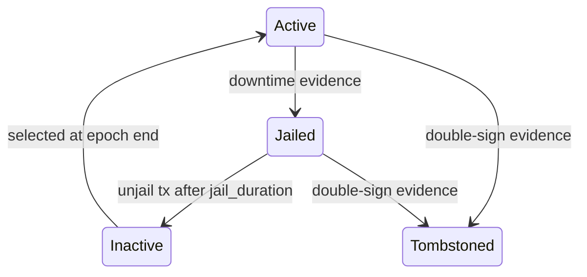

# Slashing and jailing

## Offence catalogue

| Offence | Evidence | Typical response | Notes |
|---|---|---|---|
| Double sign / equivocation | two signed conflicting votes or proposals, same height/round | large slash + permanent tombstone | provable, so harsh penalties are fair |
| Downtime (liveness) | missed ≥ X of the last N blocks (on-chain signing info) | small slash + jail for a period | must tolerate brief outages; avoid punishing correlated network incidents harshly |
| Invalid block / state proposal | fraud proof, or the block fails validation | slash (if provable) | in BFT, invalid proposals are usually just rejected |
| Light-client attack / fork evidence | conflicting signed headers | slash all signers | needed when bridges/IBC rely on your headers |
| Misbehaviour in other bonded roles (verifiers, sequencers, operators) | verifiable proof per protocol (wrong result with proof, missed challenge) | role-specific slash | define in protocol-verifiable-participation |

Correlated slashing (penalty grows with the number of validators slashed in the same window) discourages coordinated attacks while sparing isolated mistakes.

## Parameters (decide and publish)

| Parameter | Considerations |
|---|---|
| `P-STAKE-slash_double_sign` | High enough to make attacks unprofitable relative to bribes |
| `P-STAKE-slash_downtime` | Low. Downtime is usually an accident |
| `P-STAKE-signed_blocks_window`, `min_signed_per_window` | Window long enough to ignore short outages |
| `P-STAKE-jail_duration` | Long enough to fix infrastructure, short enough to not lose good operators |
| `P-STAKE-unbonding_period` | Longer than the evidence max age. Cosmos v0.55 notes evidence against rotated keys stays attributable until both `evidence.max_age_num_blocks` and `max_age_duration` elapse, which can exceed unbonding ✔ |
| `P-STAKE-evidence_max_age` | Equals or exceeds the time needed to detect and submit evidence |
| Slashed funds destination | burn / treasury / insurance pool / redistribution to victims |

Real chains' values are useful as anchors but differ by chain economics. Cite the chain and date if you copy one.

## Redistribution caution
Sending slashed funds to a party creates an incentive to slash. EigenLayer documents this explicitly for redistributable operator sets, which must be declared at creation and can't be switched off later ✔. If you redistribute, the slashing decision must be objective (proof-based), with a delay and a veto/appeal path.

## Jail lifecycle

Sources (2026-11-25): https://docs.cosmos.network/sdk/latest/upgrade/v0.55 · https://docs.eigencloud.xyz/eigenlayer/concepts/slashing/redistribution
