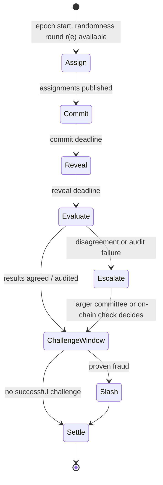

# Assignment → commit → reveal → challenge → settle

A generic, stack-neutral template. Copy it into `docs/spec/<service>.md` via `design-spec`, and adapt the names.

## State

| Name | Type | Notes |
|---|---|---|
| `nodes` | Map<NodeId, {operator: Address, bond: Amount, status: Enum{Active, Paused, Exiting, Slashed}, registered_epoch: Epoch, weight: Amount}> | weight = bond, or verified-work score, capped |
| `tasks[e]` | List<Task, P-PART-max_tasks_per_epoch> | created from chain data (e.g. block heights to verify, shares to serve) |
| `assignments[e]` | Map<TaskId, List<NodeId, k>> | derived from randomness round r(e) |
| `commits[e]` | Map<(TaskId, NodeId), Hash> | `H(result ‖ salt ‖ node_id)` |
| `reveals[e]` | Map<(TaskId, NodeId), Result> | |
| `challenges` | Map<ChallengeId, {task, challenger, bond, deadline, status}> | |
| `rewards_pending` | Map<NodeId, Amount> | claimable after the settlement window |

## Lifecycle per epoch e



## Operations (sketch, using design-spec notation)

```
op Register(operator, node_keys, bond)            checks: bond ≥ P-PART-min_bond; effects: node Active from next epoch
op Commit(node, task, h)                          checks: node assigned to task in e; before commit deadline; once
op Reveal(node, task, result, salt)               checks: H(result‖salt‖node) == commit; before reveal deadline
op SubmitClaim(node, e, root, total_units)        (claims variant) checks: one claim per node per session/epoch
op SubmitProof(node, e, leaf, merkle_path)        (claims variant) checks: proof required by r(e)-derived selection; before proof deadline
op Challenge(challenger, task, evidence, bond)    checks: within window; bond ≥ P-PART-challenge_bond
op Exit(node)                                     effects: Exiting; bond released after P-PART-exit_delay ≥ challenge window
```

## Hooks
`EndEpoch(e)`: process at most `P-PART-max_settle_per_block` items per block (spread over blocks if needed). Pay `rewards_pending` from the epoch budget pro rata to verified units, with dust to reserve. Non-revealers get zero (no slash unless non-reveal is strategic and provable). Fraud → slash `P-PART-slash_fraction` of the bond, with the challenger's reward ≤ the slashed amount.

## Parameters
`min_bond`, `k` (redundancy), `audit_rate`, `canary_rate`, commit/reveal/challenge windows, `slash_fraction`, `challenge_bond`, `exit_delay`, `epoch_budget` (from tokenomics), `max_weight_per_operator`.

## Invariants
- `INV-PART-1` Σ rewards(e) ≤ epoch_budget(e)
- `INV-PART-2` every paid unit has a verification record
- `INV-PART-3` assignment randomness round > registration lock round
- `INV-PART-4` slash ≤ bond; challenger reward ≤ slash
- `INV-PART-5` a node cannot commit twice for the same task
- `INV-PART-6` bonds are released only after every window in which the node could be slashed has closed
